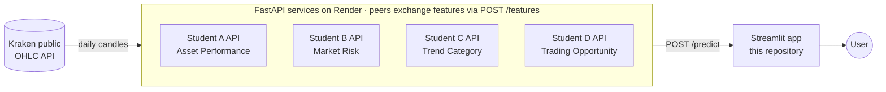

# Group 08 – Crypto Market Intelligence Platform (Streamlit app)

**One web application that brings together four machine-learning forecasting services, each predicting crypto-market conditions seven days ahead.**


| | |
|---|---|
| **Live app** | _Streamlit Community Cloud URL – add after deployment_ |
| **Subject** | 36120 Advanced Machine Learning Application, Spring 2026, University of Technology Sydney – AT3 Data Product with Machine Learning |
| **Group** | 08 |
| **Data source** | Kraken public OHLC API (daily USD candles), fetched by the services at request time |
| **Repositories** | See [`github.txt`](github.txt) |

---

## Contents
1. [Group members](#1-group-members)
2. [Overview](#2-overview)
3. [Pages](#3-pages)
4. [Architecture](#4-architecture)
5. [Quick start](#5-quick-start)
6. [Configuration – connecting the APIs](#6-configuration--connecting-the-apis)
7. [Run with Docker](#7-run-with-docker)
8. [Deploy on Streamlit Community Cloud](#8-deploy-on-streamlit-community-cloud)
9. [Project structure](#9-project-structure)
10. [Adding or updating a student page](#10-adding-or-updating-a-student-page)
11. [Reliability and failure handling](#11-reliability-and-failure-handling)
12. [Testing and quality](#12-testing-and-quality)
13. [Collaboration workflow](#13-collaboration-workflow)
14. [Troubleshooting](#14-troubleshooting)
15. [Responsible use](#15-responsible-use)
16. [AI usage acknowledgement](#16-ai-usage-acknowledgement)

---

## 1. Group members

| Role | Target | Student name | Student ID | Page |
|---|---|---|---|---|
| Student A | Asset Performance Index – API | Ryan Cruikshank | 13191263 | `students/student_a.py` |
| Student B | Market Risk Index – MRI | Vignesh Selvam | 25740287 | `students/student_b.py` |
| Student C | Trend Category – TC | Nandeeswari Kumaravelu | 25980436 | `students/student_c.py` |
| Student D | Trading Opportunity Rating – TOR | Vinnie Bui | 26160438 | `students/student_d.py` |

---

## 2. Overview

The app gives an investor a single place to answer four questions about the coming week:

| Question | Indicator | Page |
|---|---|---|
| How is the asset performing? | Asset Performance Index (0–100) | Asset Performance (A) |
| How risky will it be? | Market Risk Index (0–100) | Market Risk (B) |
| Which way is the trend heading? | Trend Category (Strong Downtrend … Strong Uptrend) | Trend Category (C) |
| Is it a good time to act? | Trading Opportunity Rating (Strong Sell … Strong Buy) | Trading Opportunity (D) |

Each indicator comes from its own FastAPI service deployed on Render. The app runs **no model itself**: it only calls the services, caches their answers and presents them with explanations.

The group product covers **Bitcoin** across all four indicators. **Market Risk (B)** and **Trading Opportunity (D)** go further and cover all eight supported tokens: BTC, ETH, XRP, SOL, DOGE, XLM, TRX and XMR — each is served by a single model pooled across the eight, so their per-token numbers are directly comparable.

---

## 3. Pages

| Page | URL path | Content |
|---|---|---|
| **Overview** | `/` | Product summary and headline metrics. Live **status of all four services**, which also wakes sleeping Render instances. A **market-risk snapshot** ranking all eight tokens by next week's risk. A system architecture diagram, team cards, a token-coverage matrix and the shared methodology. |
| **Asset Performance (A)** | `/performance` | Student A's page |
| **Market Risk (B)** | `/market-risk` | Four tabs, described below |
| **Trend Category (C)** | `/trend` | Student C's page |
| **Trading Opportunity (D)** | `/opportunity` | Four tabs, described below |

**Market Risk (B) tabs**
- **Forecast:**
  - today's and next week's index, the risk band, the forecast date and the model used
  - a 0–100 risk scale and a plain-language analyst summary
  - the market inputs with their data sources, and today's risk broken into its four parts
  - price and risk history from 30 to 365 days, with the forecast drawn on
  - a SHAP chart explaining the forecast
- **All 8 tokens:** a ranked comparison chart and table, with summary metrics.
- **Model & methodology:**
  - test accuracy against the persistence and mean baselines
  - a diagram of how a prediction is made
  - permutation importance and accuracy when a peer service is down
  - the Optuna hyperparameters and the model's limitations
- **API:** the endpoint list, live status and latency, an example request, the live JSON response and the error format.

**Trading Opportunity (D) tabs**
- **Rating:**
  - the rating for t+7, its confidence and confidence band, and what the rating implies as an action
  - the probability across all five ratings, including any the model gives no mass to
  - an analyst summary assembled only from values the API returned
  - the model inputs with the service each came from, and relative-volume and price history
- **All 8 tokens:** every token ranked best-opportunity-first; a token whose call failed is listed as Unavailable rather than dropped.
- **Model & methodology:** test metrics, the comparison against all four baselines, the confusion matrix, feature importance by owning student, per-class recall, the peer-outage degradation table, per-token reliability and the tuning setup.
- **API:** the endpoint list, live status, an example request, the live JSON response and the error contract.

Every figure on D's page is read from `GET /model-metadata`, never written into the page, so it cannot
drift from the artefact the service loaded. Where the metadata shows the model losing to the
persistence baseline on macro-F1 — which it currently does — the page says so in a warning above the
comparison table rather than leaving the reader to work it out.

---

## 4. Architecture



- **Feature exchange:** each service owns some engineered features and serves them on `POST /features`; the others call it. The contract is in `CONTRACT.md` in the experiments repository.
- **Single source of truth:** a feature formula is written once, not re-typed per service. Students A–C install the published package [`mykrml-25740287`](https://test.pypi.org/project/mykrml-25740287/); Student D's service vendors a byte-identical copy of the same group implementation under `app/core/`, refreshed by a sync script, because it must stay independently deployable. Either route, training and serving share one code path.
- **The app** calls `POST /predict` (and `/risk-history` and `/model-metadata` for the Market Risk page). Successful answers are cached for 10 minutes.

---

## 5. Quick start

**Requirements:** Git and [uv](https://docs.astral.sh/uv/). uv installs Python 3.12.13 and the pinned packages.

```bash
git clone https://github.com/vigneshcrack/36120-26SP-AT3-Group08-streamlit.git
cd 36120-26SP-AT3-Group08-streamlit
uv python install 3.12.13
uv sync
uv run streamlit run app/main.py        # opens http://localhost:8501
```

**Without uv:**
```bash
python -m venv .venv
source .venv/bin/activate               # Windows PowerShell: .venv\Scripts\Activate.ps1
pip install -r requirements.txt
streamlit run app/main.py
```

Pinned versions: Streamlit 1.59.0, pandas 2.2.2, Altair 6.3.0, requests 2.34.2 (`requirements.txt` / `uv.lock`).

---

## 6. Configuration – connecting the APIs

Each page finds its service through `core.api_url("student_x")`, which checks three places in order:

1. the environment variable `STUDENT_X_API_URL`, for example `STUDENT_B_API_URL`;
2. the same key in **Streamlit secrets**: `.streamlit/secrets.toml` locally, or **App settings → Secrets** on Streamlit Cloud;
3. the default in the `TEAM` table in `app/main.py`. Student B's and Student D's live URLs are preset there.

```toml
# .streamlit/secrets.toml   (copy from .streamlit/secrets.toml.example – never commit this file)
STUDENT_A_API_URL = "https://<student-a-service>.onrender.com"
STUDENT_B_API_URL = "https://group08-studentb-mri-api.onrender.com"
STUDENT_C_API_URL = "https://three6120-26sp-at3-group08-studentc-api.onrender.com/"
STUDENT_D_API_URL = "https://three6120-26sp-at3-group08-studentd-api-1.onrender.com"
```

When a teammate deploys, adding their URL as a secret is enough. **No code change is needed.**

---

## 7. Run with Docker

Requires [Docker Desktop](https://www.docker.com/products/docker-desktop/) to be running ("Engine running").

```bash
docker build -t group08-streamlit .
docker run --rm -p 8501:8501 group08-streamlit
# → http://localhost:8501
```

To override an API URL:
```bash
docker run --rm -p 8501:8501 -e STUDENT_A_API_URL=https://<student-a>.onrender.com group08-streamlit
```

**What the image does:**
- Uses `python:3.12.13-slim`.
- Installs dependencies before copying the code, so rebuilds are quick.
- Runs as a **non-root user**.
- Has a **health check** on Streamlit's `/_stcore/health`. `docker ps` shows the container as `(healthy)` within about 30 seconds.

Stop the container with **Ctrl+C**, or with `docker stop <container-id>`.

---

## 8. Deploy on Streamlit Community Cloud

1. Push to the `main` branch of this private repository (through a pull request, see §13).
2. Go to https://share.streamlit.io → **Create app** → **Deploy a public app from GitHub**. Authorise Streamlit for private repositories when asked.
3. Repository: `vigneshcrack/36120-26SP-AT3-Group08-streamlit`. Branch: `main`. **Main file path: `app/main.py`**.
4. **Advanced settings:**
   - Python version **3.12**. Community Cloud offers minor versions only; 3.12.13 is used locally and in Docker.
   - Paste the API URLs into **Secrets**, as in §6.
5. **Deploy.** Each later push to `main` redeploys automatically.

---

## 9. Project structure

The repository follows the structure required by the AT3 brief:

```
project/
├── app/
│   └── main.py          # entry point + shared building blocks (five sections, see below)
├── students/
│   ├── student_a.py     # Asset Performance Index page
│   ├── student_b.py     # Market Risk Index page (all 8 tokens)
│   ├── student_c.py     # Trend Category page
│   └── student_d.py     # Trading Opportunity Rating page
├── requirements.txt     # pinned versions (Streamlit Cloud and Docker)
├── pyproject.toml       # uv project (Python 3.12.13)
├── Dockerfile           # container image
├── github.txt           # links to all group repositories and deployments
└── README.md
```

Supporting files:
- `tests/`: the pytest suite.
- `.streamlit/config.toml` (theme) and `.streamlit/secrets.toml.example`.
- `uv.lock`, `.python-version`, `.gitignore`, `.dockerignore`.

**`app/main.py` has five sections:**
1. **Group configuration:** team, tokens and API URLs.
2. **Presentation helpers:** page styling, hero banner, status pills, section labels.
3. **Shared HTTP client:** timeouts, retries and caching. It never raises; it returns a result object.
4. **Overview page:** service status, market snapshot, architecture, team, coverage and methodology.
5. **Navigation:** `st.navigation` with one `st.Page` per student.

Page setup and navigation only run when Streamlit executes the file. Importing it from a student page therefore has no side effects.

---

## 10. Adding or updating a student page

Each page is a module in `students/` that exposes a `render()` function and imports the shared helpers:

```python
import streamlit as st

from app import main as core

def render() -> None:
    core.inject_css()
    core.hero("Student X · Name (ID)", "Indicator - 7-day forecast", "One-line description.", ["badge", "badge"])
    result = core.cached_call(core.api_url("student_x"), "/predict", {"token": "BTC", "forecast_horizon": 7})
    if not result.ok:
        st.error(f"Could not load the forecast: {result.error}")
        return
    st.metric("Forecast", result.data["prediction"])
```

**Rules:**
- Prefix widget keys with your letter (for example `key="a_token"`) so they never clash with other pages.
- Always check `result.ok` before using the data.
- Add tests in `tests/` and run `uv run pytest` before opening a pull request.

---

## 11. Reliability and failure handling

| Situation | Behaviour |
|---|---|
| Service asleep (Render free tier) | Spinner. The request waits up to 70 s and is retried once. The Overview status check wakes all services |
| Service down or timing out | A clear error message with a hint and a **Refresh data** button, never a stack trace |
| Service returns a 4xx error | The service's own `error` message is shown. Bad requests are not retried |
| Service returns a 5xx error | Retried once, then reported |
| Peer feature missing inside a service | The page explains which inputs were missing, or that they were reused or recomputed |
| One token fails in the comparison | The other tokens are still shown, and the failed ones are listed |
| API URL not configured yet | The page shows that the service is not deployed yet |

Successful responses are cached for 10 minutes (`st.cache_data`). Failures are **never** cached, so "Refresh data" really retries. The eight-token comparison runs its requests concurrently.

---

## 12. Testing and quality

```bash
uv run pytest      # 79 tests, no network needed
uv run ruff check .
```

The services are replaced by canned responses with the same structure as the live Market Risk and Trading
Opportunity APIs. The tests cover:

- **HTTP client:**
  - a success
  - a 4xx response that is not retried
  - timeouts and 5xx responses that are retried
  - invalid JSON and a missing URL
  - failures that are never cached
- **Chart and explanation helpers:** risk bands, number formatting, SHAP contribution ordering, the plain-language summary, component totals, and every chart's specification.
- **Trading Opportunity helpers:** the ordered rating scale and confidence bands, the probability
  distribution (which always shows all five ratings, even ones the model gives no mass to), per-token
  ranking that keeps failed tokens visible, the baseline comparison built from `/model-metadata`, the
  confusion matrix and feature-importance frames, the plain-language summary, and every chart's
  specification. The metadata-shape tests run against a response **captured from a running service**
  (`tests/fixtures/student_d_model_metadata.json`) rather than a hand-written fixture: a hand-written
  one is what previously hid a real bug, because it was written from the training artefact's flat
  shape and so agreed with the page's wrong assumption about where the service nests its extras.
- **Pages,** using Streamlit's `AppTest`:
  - the Market Risk page with all four tabs
  - the Trading Opportunity page, including that it offers all eight tokens and warns when the model
    does not beat the persistence baseline
  - an API outage and the fallback-model warning
  - changing the token
  - the Overview page, under normal conditions and during an outage

---

## 13. Collaboration workflow

- **Branch protection:** `main` requires a pull request with one approving review, and direct pushes are blocked.
- **Branches:** each student works on their own branch (for example `student-b/...`) and opens a pull request into `main`.
- **Escalation:** under `CONTRACT.md` §11, if no review arrives within 24 hours and a milestone is at risk, the group lead may merge with the owner's bypass. The reason and the passing checks are recorded on the pull request.
- **Before merging:** `uv run pytest` and `uv run ruff check .` must pass.

---

## 14. Troubleshooting

| Symptom | Cause and fix |
|---|---|
| A page shows "waking up" or the first load is slow | Render free instances sleep. Open the Overview, which wakes all services, and wait about a minute |
| "This API has not been deployed or configured yet" | Add `STUDENT_X_API_URL` to the secrets (§6) |
| `ModuleNotFoundError: app` or `students` | Run from the repository root: `streamlit run app/main.py` |
| Docker "port is already allocated" | An old container is still running: `docker ps`, then `docker stop <id>` |
| Charts look empty after a deploy | Press **Refresh data**. Cached failures are never kept, so this forces a new call |

---

## 15. Responsible use

The app provides **general information for educational purposes, not financial advice**:
- Each forecast is shown with its explanation, its measured accuracy against simple baselines, and its known limitations.
- The app collects no personal data and has no accounts or forms of its own.
- Any future feature that stores user data must comply with the *Privacy Act 1988* (Cth). It must also follow Indigenous data-sovereignty principles (CARE; Maiam nayri Wingara).

---

## 16. AI usage acknowledgement

Generative AI (Claude) was used to support the design, coding, testing and documentation of this application, in line with the subject's AI usage policy. All code was reviewed, executed and tested by the students, who can explain and justify every design decision.
